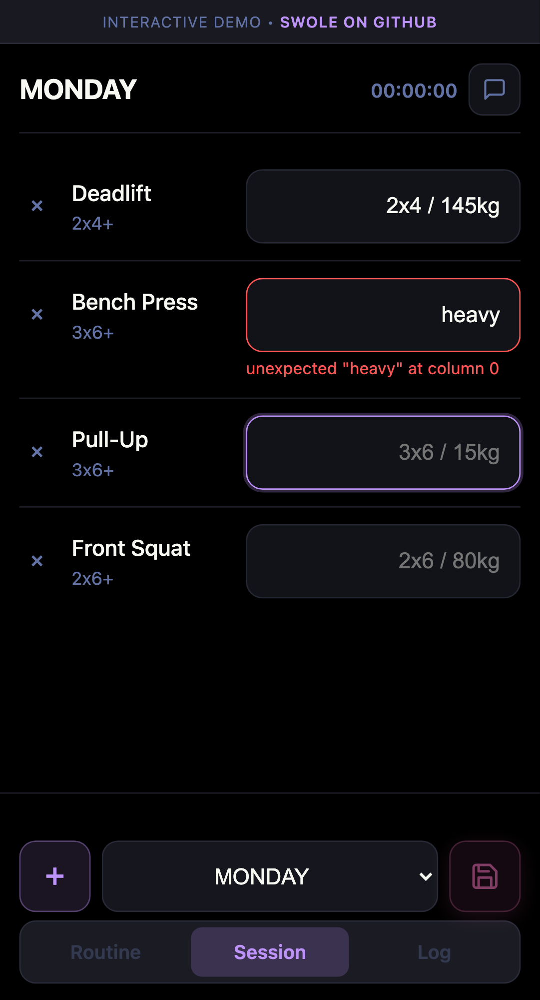

# swole

One workout logger with one UI and one model in JS, running on five backends. Exercise lines use [workline](workline/SPEC.md) notation: `Deadlift / 2x4 / 140kg`.



Regenerate with `npm run build && npm run screenshot`.

| Runtime | Store                                         | Where                          |
| ------- | --------------------------------------------- | ------------------------------ |
| local   | git repo, `data/`                             | `npm run serve`, CLI           |
| apk     | git repo in IndexedDB (isomorphic-git)        | Android WebView shell, offline |
| gas     | gswole Google Sheet, `routine` and `log` tabs | Apps Script web app            |
| cf      | Workers KV                                    | Cloudflare Worker              |
| demo    | localStorage, seeded from `sample/`           | GitHub Pages                   |

## Use

```sh
npm ci
npm run setup                 # core.hooksPath=.githooks
npm run build                 # dist/{local,demo,apk,gas}, android assets
node src/cli.js start [DAY]   # writes and commits data/session.txt; DAY defaults to today
node src/cli.js stop          # stamps END, commits
node src/cli.js save          # moves it to data/log/<yy>/<ww>/<unix>.txt, commits, pushes if a remote is set
npm run serve                 # UI and api on 127.0.0.1:4173
```

The service fires post-start, post-stop and post-save. Git hooks cover manual git use: pre-commit validates `data/` lines, post-commit fires the lifecycle event, and pre-push runs check and tests when the push carries code.

Over HTTP, `POST /api/start` with `{"day":"MONDAY"}` starts the same session; `day` is optional and defaults to today. The matching routes are `/api/load`, `/api/stop`, `/api/save` and `/api/track`.

## Data and privacy

Local CLI runs append telemetry to `data/telemetry.jsonl`: call names, durations, outcomes, counts and error strings. It makes no third-party network call, and `/data/*` is gitignored, so telemetry and sessions leave the machine only when you push the data repository. Sessions can equally live in a git remote, Workers KV, a Google Sheet or browser storage, each controlled by whoever deploys that backend.

## Data and mirror

`data/` lives on Forgejo only. `npm run mirror` filters it out of a temp clone and pushes `main` and tags to GitHub. It refuses to push if any `data/` path or `.clasprc.json` remains.

## Publication setup

Owner-scoped ids are not committed. A fork must supply its own:

- Apps Script: `cp .clasp.example.json .clasp.json` and set `scriptId`. `deploy-gas.yml` instead generates `.clasp.json` from the `CLASP_SCRIPT_ID` secret and reads the fixed deployment from the `GAS_DEPLOYMENT_ID` repository variable.
- Worker: create your own namespace with `npx wrangler kv namespace create SWOLE_KV` and put its id in `wrangler.toml`, or keep a gitignored `wrangler.local.toml` and run `npx wrangler deploy -c wrangler.local.toml`.

`.clasp.json`, `.clasp.json.local` and `wrangler.local.toml` are gitignored.

## Deploys

- Apps Script: `deploy-gas.yml` runs `clasp push` and redeploys the fixed web app deployment. It needs the `CLASPRC_JSON` and `CLASP_SCRIPT_ID` secrets plus the `GAS_DEPLOYMENT_ID` repository variable.
- APK: `apk.yml` builds a debug APK and attaches it to a release on a `v*` tag. Install with `adb -s <device-serial> install app-debug.apk`.
- Worker: create the KV namespace, set its id in `wrangler.toml` (or `wrangler.local.toml`), then `npx wrangler deploy`.
- Demo: `pages.yml` publishes `dist/demo`.
